# Lab8Web - Praktikum 8: PHP dan Database MySQL

**Nama:** Muhammad Zaki Ramadhan

**NIM:** 312510100

**Kelas:** 1.25.2A

## Tujuan
1. Memahami konsep dasar database.
2. Memahami konsep dasar CRUD menggunakan PHP.
3. Membuat program CRUD sederhana menggunakan PHP.

## Struktur Folder
```
lab8_php_database/
├── gambar/          (folder untuk menyimpan gambar upload)
├── screenshot/      (folder bukti hasil praktikum)
├── database.sql
├── koneksi.php
├── index.php
├── tambah.php
├── ubah.php
├── hapus.php
├── style.css
└── README.md
```

---

## 1. Persiapan: Menjalankan MySQL Server
Buka **XAMPP Control Panel**, lalu klik **Start** pada modul **Apache** dan **MySQL** sampai statusnya berwarna hijau.

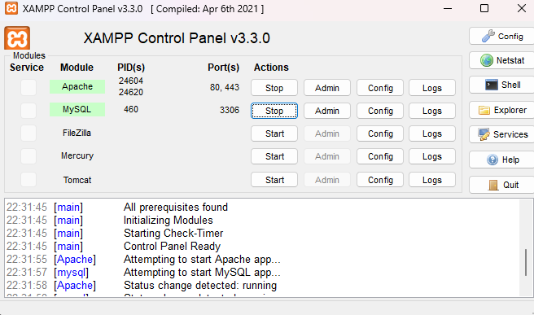

## 2. Mengakses MySQL Client dengan phpMyAdmin
Buka browser dan akses `http://localhost/phpmyadmin/`.

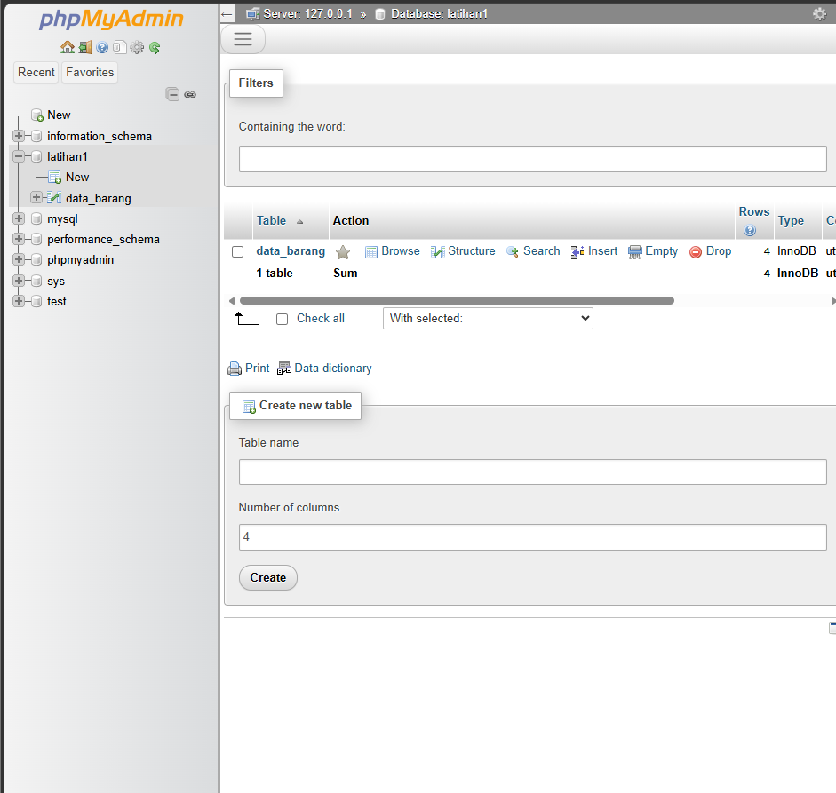

## 3. Membuat Database
Di tab **SQL** phpMyAdmin, jalankan:
```sql
CREATE DATABASE latihan1;
```

## 4. Membuat Tabel
Pilih database `latihan1`, lalu jalankan:
```sql
CREATE TABLE data_barang (
  id_barang int(10) auto_increment Primary Key,
  kategori varchar(30),
  nama varchar(50),
  gambar varchar(100),
  harga_beli decimal(10,0),
  harga_jual decimal(10,0),
  stok int(4)
);
```
Tabel `data_barang` menyimpan data barang: id (primary key, auto increment), kategori, nama, gambar, harga beli, harga jual, dan stok.

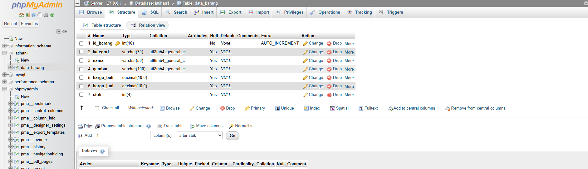

## 5. Menambahkan Data
```sql
INSERT INTO data_barang (kategori, nama, gambar, harga_beli, harga_jual, stok)
VALUES ('Elektronik', 'HP Samsung Android', 'hp_samsung.jpg', 2000000, 2400000, 5),
('Elektronik', 'HP Xiaomi Android', 'hp_xiaomi.jpg', 1000000, 1400000, 5),
('Elektronik', 'HP OPPO Android', 'hp_oppo.jpg', 1800000, 2300000, 5);
```
Cek dengan `SELECT * FROM data_barang;`

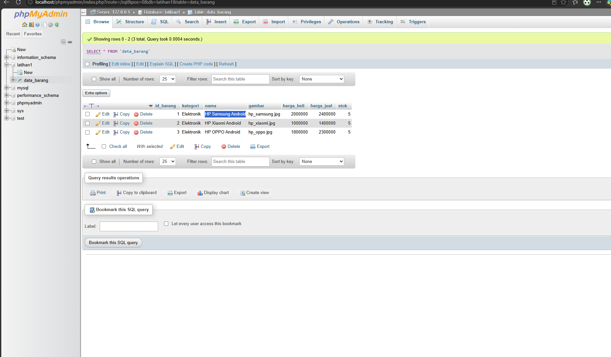

## 6. Membuat Folder Program CRUD
Buat folder `lab8_php_database` di `C:\xampp\htdocs` (atau `d:\xampp\htdocs`), lalu buat juga subfolder `gambar`. Akses melalui `http://localhost/lab8_php_database/` (atau `http://localhost:8000/` jika memakai built-in server PHP di VS Code).

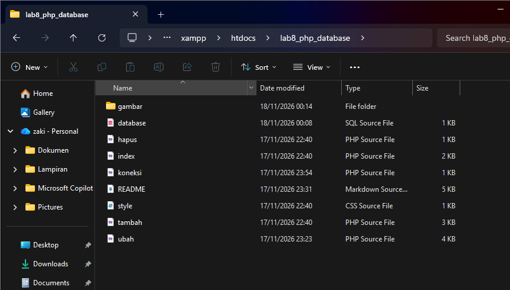

## 7. File Koneksi Database (`koneksi.php`)
File ini membuat koneksi ke MySQL memakai `mysqli_connect()` dengan host `localhost`, user `root`, password kosong, dan database `latihan1`. Jika koneksi gagal, program menampilkan pesan error dan berhenti (`die()`). Untuk menguji, hilangkan komentar pada `echo "Koneksi berhasil"` lalu buka `koneksi.php` di browser. Setelah pengujian, baris tersebut dikomentari kembali agar tulisannya tidak muncul di halaman lain.

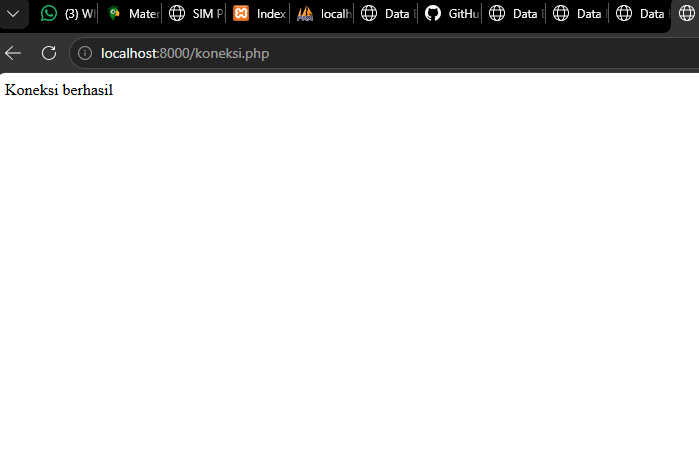

## 8. Menampilkan Data - Read (`index.php`)
`index.php` meng-include `koneksi.php`, menjalankan `SELECT * FROM data_barang`, lalu menampilkan hasilnya dalam tabel menggunakan `mysqli_fetch_array()` di dalam perulangan `while`. Setiap baris punya tautan **Ubah** dan **Hapus**, dan ada tautan **Tambah Barang** di atas tabel.

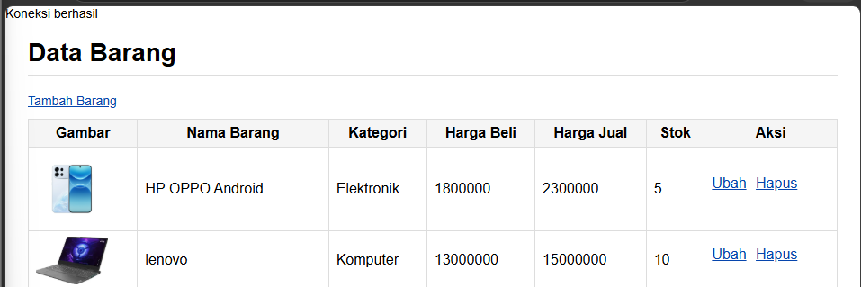

## 9. Menambah Data - Create (`tambah.php`)
Form berisi nama, kategori, harga jual, harga beli, stok, dan upload gambar (`enctype="multipart/form-data"`). Saat tombol **Simpan** ditekan, data dibaca dari `$_POST`, file gambar dipindahkan ke folder `gambar/` dengan `move_uploaded_file()`, lalu data di-`INSERT` ke database dan halaman diarahkan kembali ke `index.php`.

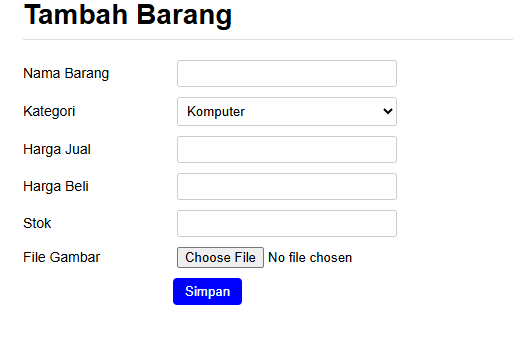

## 10. Mengubah Data - Update (`ubah.php`)
Halaman ini mengambil `id` dari URL (`$_GET['id']`), membaca data lama dari database, dan menampilkannya di form. Setelah **Simpan**, data di-`UPDATE` berdasarkan `id_barang`. Gambar hanya diganti bila ada file baru yang diunggah.

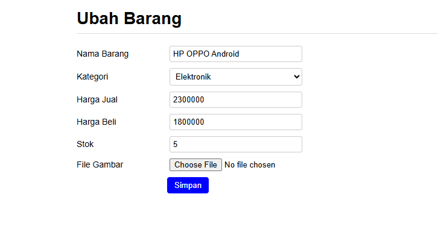

## 11. Menghapus Data - Delete (`hapus.php`)
Mengambil `id` dari URL (dengan casting `(int)`), lalu menjalankan `DELETE FROM data_barang WHERE id_barang = ...`, kemudian kembali ke `index.php`. Sebelum data dihapus, browser menampilkan dialog konfirmasi "Hapus data ini?".

Dialog konfirmasi sebelum data dihapus:

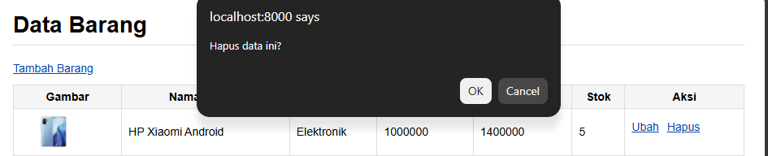

Tampilan index setelah data dihapus:

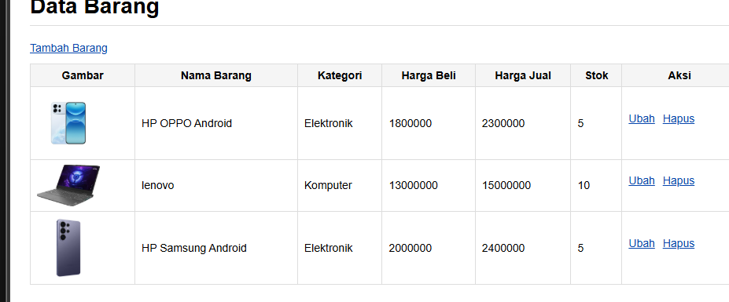

---

## Catatan Perbaikan dari Kode Modul
- Urutan kolom `index.php` disesuaikan dengan urutan data (Harga Beli lalu Harga Jual); di modul header dan datanya tertukar, serta kolom Aksi hanya menampilkan id.
- Menambahkan tautan **Tambah Barang**, **Ubah**, dan **Hapus** di `index.php`.
- `enctype="multipart/formdata"` di `ubah.php` diperbaiki menjadi `multipart/form-data`.
- Pilihan kategori di `ubah.php` memakai nilai pembanding yang benar untuk tiap opsi.
- Query memakai *prepared statement* / casting integer untuk mencegah SQL injection.
- Tipe kolom `nama` dibuat `varchar(50)` sesuai tabel rancangan di modul.
